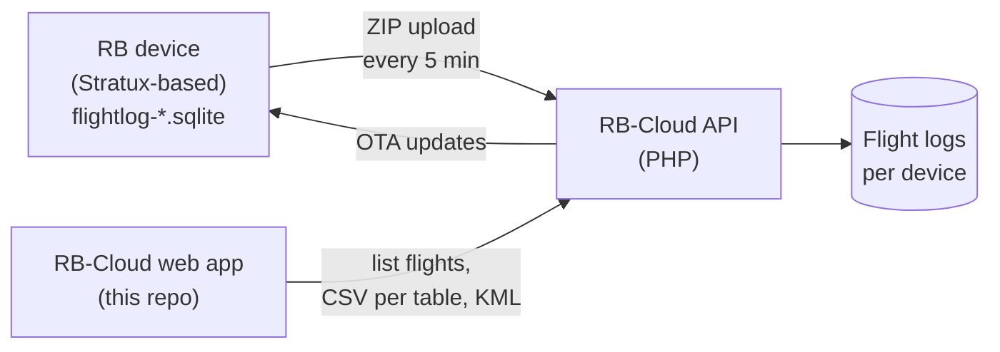

# RB-Cloud

RB-Cloud is the web companion of the **RB-Avionics** open-source, open-design avionics. After a flight, your RB device uploads its flight log. RB-Cloud lets you browse your flights, chart GPS, attitude and engine data, and export the track to Google Earth.

This repository contains the web front end.

**▶ Live app: https://app.rbavionics.com/**

To try it without a device, open **Settings** and enter Device `DEMO` and Token `DEMO` (these are the defaults). Then go to **Charts**.

## Features

| Section | Status | What it does |
|---|---|---|
| **Charts** | Available | Pick a flight and plot one of the presets below. Add as many charts as you like with **Create new chart**. |
| **Flight Map** | Available | Tick one or more flights to draw their GPS tracks on OpenStreetMap, with an OpenAIP airspace overlay you can switch on. The first three get their own color; point at or tap a track to see which flight it is. |
| **Pilot Logbook** | Available | Every flight of the device with date, start and end time (UTC; from the first GPS speed above 50 km/h to the last drop below it), maximum ground speed, maximum climb rate and maximum/minimum G-load. Logs that never go faster than 50 km/h, or where the altitude never changes by 100 m or more (the device switched on at the ground), are not listed. |
| **Engine Analysis** | Available | Total engine working time: the flight time of every flight, added up. For the selected flight: min, max, average and 95th percentile of every engine sensor, with glitches skipped, a PASS/FAILURE check against typical limits for a 4-cylinder boxer engine, and a flag when a value is outside this engine's usual range. Engine history over all flights: a sensor-health grid (faults, missing probes, limits), trend charts per sensor, and a cooling-performance chart (CHT against outside air temperature) that tells a hot day from an engine running hot. |
| **Settings** | Available | Device identifier and access token. They are stored only in your browser's local storage. |
| **Summary** | Available | Minutes flown in each month of the year (each flight from the first GPS speed above 50 km/h to the last drop below it), with a year selector. |
| Documents, Maintenance, Live Monitoring | Coming | Planned for the Professional subscription. Ask on [Discord](https://discord.gg/G4u6kjmrUG). |

Chart presets:

| Button | Plots |
|---|---|
| **F**: Flight | GPS ground speed, pressure altitude |
| **M**: Magnetometer | Magnetometer X/Y/Z, magnetic heading, GPS true course |
| **G**: Attitude | Pitch, roll, G-load |
| **E**: Engine | RPM, CHT, EGT, oil temperature, outside air temperature |
| **K**: KML | Downloads the GPS track as a time-stamped KML file. Use the time slider in Google Earth to replay the flight. |

The app is built mobile-first and has a full-screen button, so it works on desktop, phones and cockpit tablets.

## Using it with your aircraft

1. Install the uploader, [rb-cloud-upload](https://github.com/xiaprojects/rb-cloud-upload), on your RB device. While the device is running, the uploader sends the flight logs (`flightlog-YYYYMMDDhhmmss….sqlite`) to RB-Cloud every 5 minutes.
2. Get a device identifier and access token from the RB-Avionics team on [Discord](https://discord.gg/G4u6kjmrUG). One token can grant access to several devices.
3. Open https://app.rbavionics.com/, go to **Settings**, and enter the identifier and token.
4. Open **Charts**, select a flight, and press a preset button.

## How it works



- Flight logs are SQLite databases in the Stratux data-log format. The charts use two tables: `mySituation` (GPS, barometer, AHRS, magnetometer) and `ems` (engine sensors).
- The web app and the API are served from the same origin: the app at `/` and the API at `/api/`. The API code lives in the separate `rb-cloud-php` repository.
- The browser sends the token as `?Authorization=<token>` on every API request.

The web app uses these API endpoints:

| Request | Response |
|---|---|
| `GET /api/flights/{deviceId}` | JSON list of flight log files |
| `GET /api/flights/{deviceId}/{file}` | Flight summary: departure and landing time, max speed, max climb rate, G range, altitude change (Summary, Pilot Logbook, Engine Analysis) |
| `GET /api/flights/{deviceId}/{file}/{table}` | The table as CSV |
| `GET /api/flights/{deviceId}/{file}/kml` | GPS track as KML |

## Development

The front end is plain HTML and JavaScript with **no build step**. All libraries are vendored in the repository.

- [AngularJS](https://angularjs.org/) 1.4.6, [AngularUI Router](https://ui-router.github.io/) 0.2.15, [Mobile Angular UI](http://mobileangularui.com/) (Bootstrap 3, Font Awesome 4.4)
- [Chart.js](https://www.chartjs.org/) 4.5.0 with [Luxon](https://moment.github.io/luxon/) 3.7.2 and chartjs-adapter-luxon 1.3.1

### Run locally

```bash
git clone https://github.com/xiaprojects/rb-cloud.git
cd rb-cloud
node tests/server.mjs
```

Open http://127.0.0.1:8000/. The server serves your checkout and forwards every `/api/` request to the production API (a reverse proxy), so the app works with real data exactly as it does online. Use Device `DEMO` / Token `DEMO`, or your own. Edit a file and reload the page to see the change. The terminal logs each API call. You need Node.js 22 or newer, and there is nothing to install.

| Option | Effect |
|---|---|
| `--port 8080` | Listen on another port (default 8000) |
| `--host 0.0.0.0` | Let a phone or tablet on your network open the app |
| `--api URL` | Forward `/api/` to another API server, e.g. your own `rb-cloud-php` |

The API is only read. For a fully local stack, serve this repository with Apache and put the `rb-cloud-php` API folder at `/api/`. That needs PHP 8 with the `sqlite3`, `zip` and `fileinfo` extensions, plus `mod_rewrite` enabled.

### Integration test

```bash
node tests/integration.mjs
```

The test opens every page in headless Chrome, at desktop and phone sizes. It plots each chart preset with the `DEMO` flight, downloads the KML track, and checks the Summary chart, the Pilot Logbook table and the Engine Analysis table. It saves a screenshot of every step to `tests/screenshots/`. You need Node.js 22 or newer and Chrome or Chromium. There is nothing to install.

The test serves your checkout locally and forwards `/api/` to the production API, so your local changes run against real data. It only reads from the API. It exits with an error if a page fails to render, a chart series has no data, or the browser reports a JavaScript error or a failed request. Useful options:

| Option | Effect |
|---|---|
| `--url https://app.rbavionics.com/` | Test the deployed site instead of your checkout |
| `--api URL` | Forward `/api/` to another API server |
| `--viewports desktop` | Run one screen size only (`desktop`, `mobile`) |
| `--headed` | Show the browser window |

### Project structure

```
index.html            App shell: script includes, side menu, navbar
js/main.js            Angular module, routes (ui-router states), main controller
plates/*.html         One template per page
plates/js/*.js        Page controllers (charts.js holds the CSV parsing and charting,
                      flightlogs.js the flight scan used by Summary and Pilot Logbook)
css/main.css          App styles
maui/, js/*.min.js    Vendored third-party libraries
api/flightlog-…/      Sample CSV exports of the demo flight (UTF-16 encoded)
tests/                Browser integration test
```

To add a page:
1. Create a template in `plates/`.
2. Create a controller in `plates/js/`.
3. Add a state in `js/main.js`.
4. Add a `<script>` tag and a menu entry in `index.html`.

To add a chart preset, add a button to `plates/charts.html` that lists the table, time field and columns to plot.

[CLAUDE.md](CLAUDE.md) is the detailed developer guide, written for both contributors and Claude Code. It covers the chart pipeline, the data columns and known quirks.

## Contributing

Issues and pull requests are welcome. Please discuss larger changes on [Discord](https://discord.gg/G4u6kjmrUG) first.

- Keep the AGPL license header at the top of new HTML and JS files. Copy it from any existing file.
- Keep the app build-free. Vendor new libraries instead of adding a package manager.
- Run `node tests/integration.mjs` and look at the screenshots before opening a pull request.

## Related projects

| Repository | Description |
|---|---|
| [roastbeef](https://github.com/xiaprojects/roastbeef) | RB-Avionics glass cockpit (Stratux-based) |
| [rb-cloud-upload](https://github.com/xiaprojects/rb-cloud-upload) | Flight log uploader that runs on the RB device |
| `rb-cloud-php` | RB-Cloud API: flight log storage, CSV/KML export, OTA updates |

The RB family: RB-01 display with synthetic vision, autopilot and ADS-B; RB-02 SixPack; RB-03 autopilot, ADS-B, radio and flight computer; RB-04 engine monitoring system (EMS); RB-05 Stratux BLE traffic; RB-06 Android displays (6.25" to 10.2"); RB-07 RB-05 and RB-03 in one box.

## Disclaimer

RB-Cloud is a post-flight review tool. It is not certified, and you must not use it for navigation, flight planning or airworthiness decisions. The software is provided without warranty of any kind.

## License

Copyright © 2026 XIAPROJECTS SRL.

RB-Cloud is free software licensed under the [GNU Affero General Public License v3.0](https://www.gnu.org/licenses/agpl-3.0.html). The community edition is free for all builders and personal use. Dual licensing for commercial use is available; contact us on [Discord](https://discord.gg/G4u6kjmrUG).

Third-party components in `maui/`, `js/` and `css/` keep their own licenses: AngularJS, AngularUI Router, Mobile Angular UI, Bootstrap, Chart.js, Luxon, chartjs-adapter-luxon and ol-layerswitcher are MIT. OpenLayers and ol-mapbox-style are BSD-2-Clause. Font Awesome fonts are SIL OFL 1.1 and its CSS is MIT. Map data © OpenStreetMap contributors; aviation overlay © OpenAIP.
